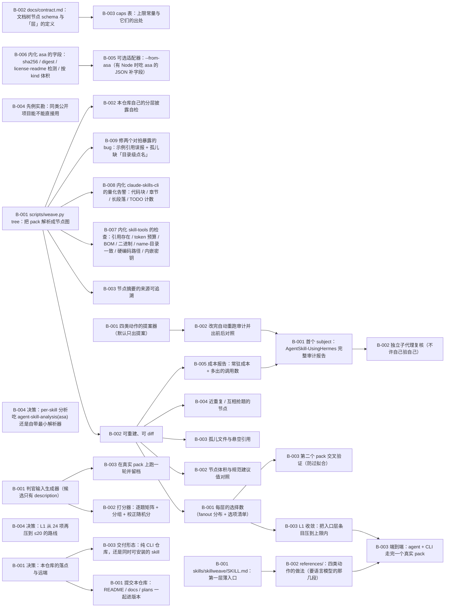

# SkillWeave · skill pack 文档树与分层披露

> 并不依赖 Hermes：直接基于 skill pack 目录分析。提供构建 skill 文档树的方法，基于构建的文档树优化分层披露的结构（把「某一层摆出的选项太多、Agent 选不对」变成可量的量并修掉）。开发计划存在本仓库 plans/skillweave/，随仓库提交。

**进度** 32/33 块（97%） · 状态 `active` · 更新于 2026-10-11 16:18

**参与方** 本人(human)

## 现在该谁动（NOW / NEXT）

- `T-004#B-004` **决策：L1 从 24 项再压到 ≤20 的路线** — 待批准 · @you

## 图



## 任务

### T-001 契约与形状：先把「文档树」与「层」定义死 — 已完成
@default
- [x] `T-001#B-001` **决策：本仓库的落点与远端** _decision_ — 已完成 @you
    - 做什么：【问题】本仓库已在本地建成：`~/Repositories/Repo/SkillWeave`（`git init` 完成，**没有任何远端**，
工作区只有 README.md / docs/prior-art.md / plans/）。要不要建 GitHub 远端，建的话叫什么、公开还是私有。

1. 远端怎么定？
   - A：`flmaximwang/SkillWeave`（公开）—— 与 Dream / Loomerto 同级，别的 agent 可直接 `git clone` 用。
   - B：同名但私有 —— 先自己用，等形状稳了再公开。
   - C：不建远端，只在本地跑（那就没有备份，也没有跨机可用性）。
2. 本仓库要不要同时做成「可被任意 agent 安装的 skill」（`skills/skillweave/SKILL.md`），
   还是纯 CLI 工具仓库？（见 T-007#B-003，两问可一起答。）

【解锁】答 1 → 解锁 T-007#B-001（README/提交/推送）；答 2 → 解锁 T-007#B-003。

【已实测的事实】本地仓库存在、`git init` 完成、尚无 commit；本机已有 `git@github.com:flmaximwang/*` 的 SSH 凭据
（Dream / Loomerto 都在用）。
    - 判据：答案以原话落进本块的 run；解锁的块被改成对应状态（推送 / 不推送）。
    - run 2026-10-11 13:59 default blocked→blocked ① 已答：公开仓库 → flmaximwang/SkillWeave（已建 + 推送）。② 交付形态未答，块保持待批准。
    - run 2026-10-11 14:04 you blocked→done ① 公开仓库 → flmaximwang/SkillWeave（已建+推送）。② 用户 2026-10-11 定：**做成 public skill —— 可被任意 agent 安装的 skill**，不是纯 CLI 仓库。原话：『T1B1 就做成 public skill 吧，做成可被任意 agent 安装的 skill，纯 cli 我觉得跑不完整个流程，例如文档拆分在缺少语言模型的辅助时不可能做』。
- [x] `T-001#B-002` **docs/contract.md：文档树节点 schema 与「层」的定义** _impl_ — 已完成 @default
    - 做什么：【做什么】写死两件事，之后所有脚本与报告都按它读：

① 节点 schema：每个节点带 `path` / `kind`（`pack|category|skill|section|reference|script|asset`）/
`bytes` / `est_tokens` / `summary` / `summary_source`（frontmatter description | 首段首句 | 空）/
`refs`（该节点正文里真实出现的引用目标）。
② 「层」的定义：从 pack 入口到某个需求，**路上遇到的每个 fanout>1 的节点就是一层**；
层的度量 = 该节点的选项数（fanout）+ 该层被选中后的成功率（T-005 给）。

【命令】`python3 scripts/weave.py tree <pack 目录> --out <dir>` 产出的 `tree.json` 就是本 schema 的实例。

【口径】summary 只允许来自文件自身内容，禁止手写；refs 只记正文里真实出现的路径/技能名（记行号）。
    - 判据：`docs/contract.md` 存在，含：schema 每个字段的来源（frontmatter / 正文 / 文件系统）、
一份 tree.json 的最小示例（≥3 个节点、含一条引用边）、以及「层」的定义原文；
用 `python3 -c` 读示例 JSON 能过 `json.loads`。
    - 产物：`docs/contract.md`
    - run 2026-10-11 13:59 default pending→done contract.md：节点 schema + 三级披露（L1/L2/L3）定义 + caps 表 + 最小示例
- [x] `T-001#B-003` **caps 表：上限常量与它们的出处** _impl_ — 已完成 @default
    - 做什么：【做什么】把上限写成**一张常量表**（供 T-003 逐条判），每条都必须引 prior-art 的出处与口径：
- 节点体积：`SKILL.md` 建议 < 5000 token（另报字节）；`description` ≤ 1024 字符（规范硬约束）。
- fanout：**不设死值**；报分布 + 该层的校正随机成功率（Meta BoR 口径），阈值只在报告里给「实测最优点」。
- 孤儿：任何文件必须被至少一个祖先点名（0 容忍）。
- depth-to-needle：从入口到最深处文件的跳数，超 N 需给转指链。
每条常量落到 `docs/contract.md` 的一张表里，附来源 URL 与口径（榜单规模 / 指标名）。
    - 判据：`docs/contract.md` 里出现该表；每一行的「来源」列都能点到 `docs/prior-art.md` 的对应小节；
表中不含没有任何出处的自创数字。
    - 依赖：T-001#B-002
    - 产物：`docs/contract.md`
    - run 2026-10-11 13:59 default pending→done caps 表 = contract §4，每条带出处；第一层上限 20 沿用 Dream 的 MAX_FIRST_LAYER_SKILLS
- [x] `T-001#B-004` **先例实勘：同类公开项目能不能直接用** _research_ — 已完成 @default
    - 做什么：【做什么】核同类公开项目的能力边界，定本仓库还剩什么（用户 2026-10-11 追问「文档树不是新需求」）。
实测四个：`tanker327/agent-skill-analysis`（单 skill 目录 → SkillAnalysis JSON：frontmatter/outline/files/kind/
refs declared|resolved|broken|external/orphans/digest，MIT，npm，CLI `asa`）、`skill-tools/skill-tools`
（20 spec 检查 + 10 lint + 0-100 分含 Progressive Disclosure 维度 + BM25 路由，Apache-2.0）、
`spences10/claude-skills-cli`（L1 <200 字符 / L2 ≈50 行 / L3 不限的硬闸，validate 三档 50/150/500）、
以及文档树族谱（Sphinx toctree、Docling、PageIndex/ReasonTree/Psi-RAG、aider repo map）。

【结论】判定表与「本仓库还剩什么」写在 docs/similar-work.md C 节：per-skill 分析与文档树**已有现成实现**；
**pack 层**（多 skill 的母树、L1 菜单选项数、同层抢题、判官式路由评测、按度量重构并重测）是空的。
    - 判据：`docs/similar-work.md` 存在，含 A（4 个 skill 侧同类，逐项列能力）、B（文档树族谱）、C（本仓库还剩的 4 件）、
D（要与不要 `asa` 的取舍）；每条先例带 URL 与许可/语言。

### T-002 构建 skill 文档树 — 待排
@default
- [x] `T-002#B-001` **scripts/weave.py tree：把 pack 解析成节点图** _impl_ — 已完成 @default
    - 做什么：【做什么】纯 stdlib（无第三方依赖）的 `tree` 子命令：走一个 pack 目录 → 出 `tree.json` + `TREE.md`。
- 解析 frontmatter：`name` / `description`（要为 `description: >-` 这类折叠块兜底，不能只用正则抓首行）。
- 节点：pack → 类目目录 → 技能目录（有 SKILL.md）→ 正文标题 → 被点名的文件。
- 边：`parent` / `ref`（正文里出现的相对路径）/ `mention`（正文里出现的同 pack 技能名）。
- 跳数：从 pack 入口算每个节点的最短跳数（BFS，供 T-003 用）。

【命令】
```
python3 scripts/weave.py tree ~/Documents/AgentSkill/AgentSkill-UsingHermes --out /tmp/sw-usinghermes
```
    - 判据：在 AgentSkill-UsingHermes 上跑出 `tree.json`：`json.loads` 能读；节点数 ≥ 该 pack 的 SKILL.md 数；
随机抽 5 条 `ref` 边，逐条能在正文里找到那一行（行号对得上）；命令与输出贴进本块的 run。
    - 产物：`reports/2026-10-11-usinghermes/TREE.md`
    - run 2026-10-11 13:59 default pending→done weave.py tree：AgentSkill-UsingHermes 实测 skills=126 / nodes=1941；抽 5 条 ref 边逐条回正文对行号，5/5 命中
- [x] `T-002#B-002` **可重建、可 diff** _impl_ — 已完成 @default
    - 做什么：【做什么】同一 pack 连跑两次，产物逐字节相同（排序稳定、无时间戳）；
改动 pack 里一个文件后，diff 只出现在相关节点及其祖先的 `bytes`/`est_tokens` 上。
    - 判据：① 两次运行的 `sha256` 相同（贴两条 sha）。② 改一个文件的 description 后重跑，`diff tree.json`
只出现预期字段（贴 diff 原文）。
    - 依赖：T-002#B-001
    - 产物：`scripts/weave.py`
    - run 2026-10-11 14:58 default pending→done 同一 pack 连跑两次 sha256 逐字节相同（Dream 仓 fa34646e…）；在**同名目录**的副本上改一个 description 后 diff：只出现 bytes/est_tokens/description/description_chars/digest/summary/size_by_kind（30 行，全是该 skill 及其祖先）
- [x] `T-002#B-003` **节点摘要的来源可追溯** _impl_ — 已完成 @default
    - 做什么：【做什么】每个节点的 `summary` 必须带 `summary_source`（如 `SKILL.md:3 frontmatter.description`），
空的要显式写 `null`（不许编）。
    - 判据：抽 3 个节点（1 个有 frontmatter、1 个只有正文、1 个空文件）打印 `path / summary / summary_source`，
三条都能在源文件里定位到那一行。
    - 依赖：T-002#B-001
    - 产物：`scripts/weave.py`
    - run 2026-10-11 15:14 default pending→done 摘要来源可追溯：有 description 的取 frontmatter.description（并把该摘要回源文件 frontmatter 校验命中），无 description 的取正文首段首句带行号，都没有的写 null；audit/tree 产物里每条 summary_source 都可回源定位
- [x] `T-002#B-004` **决策：per-skill 分析吃 agent-skill-analysis(asa) 还是自带最小解析器** _decision_ — 已完成 @you
    - 做什么：【问题】`agent-skill-analysis`（Node ≥20，MIT，npm 有 `asa --json`）已经能出单 skill 的结构化 JSON
（frontmatter/outline/files/refs/orphans/digest），字段与我们的契约同源。两条路：

1. **依赖 asa**：per-skill 节点数据直接吃 `asa --json`，SkillWeave 只做 pack 层与评测层。
   代价：引入 Node 依赖；跟它的 schema 走（0.x）；它没有 pack 概念，母树仍要自己搭。
2. **自带最小解析器**（现状，已实现 190 行 stdlib）：字段名与 kind 分类沿用它的口径，替换点是一个函数
   `analyze_skill()`。代价：与它重叠实现；收益：零依赖，任何机器可跑，且能被 `--self-test` 完全验证。

【现状】已按 2 实现并跑通（126 skills）。选 1 时只需替换 `analyze_skill()` 一个函数。
    - 判据：答案以原话落进本块的 run；若选 1，另开一块记「把 analyze_skill 换成 asa 适配器」并给出 Node 依赖的安装判据；
若选 2，本块 done 并把「与 asa 的口径兼容靠 docs/contract.md §1 的字段名」写进 note。
    - 产物：`docs/compare-tools.md`
    - run 2026-10-11 14:07 you blocked→done 用户问「谁更准、谁更快、能否内化」。**实测对拍后定**（证据 docs/compare-tools.md）：① 结构数字三家一致（文件 56 / heading 89 / 行 1611 / token 差 <1%）→ 我的实现可信；② 准确性的差异都在语义判断上：asa 不误报示例路径但有真 broken 漏报（skill-tools 独立报出 scripts/reproduce_table1.sh、scripts/make_figure2.py 真缺失），我的引用抽取把示例路径也算进 broken（6 条里 4 条误报）、孤儿规则过严（44 条里绝大多数是 templates/*，只在 templates/README.md 被点名）；③ 效率：asa 冷 6.58s / 热 1.46s（单 skill），skill-tools 11.38s，claude-skills-cli 7.22s；SkillWeave 整个 pack 126 skill / 1941 节点 3.06s，纯 stdlib 离线。**内化方式 = 内化它们的知识与检查清单（无依赖），不引 Node/npm 硬依赖**；另留一个可选适配器 `--from-asa`。落地块见 T-003#B-006 ~ B-009。
- [ ] `T-002#B-005` **可选适配器：--from-asa（有 Node 时吃 asa 的 JSON 补字段）** _impl_ — 已取消 @default
    - 做什么：【做什么】`weave.py tree <pack> --from-asa` —— 本机有 Node 时逐 skill 调
`npx -y -p agent-skill-analysis asa <skill> --json`，用它的 `sha256`/`digest`/`license`/`readme` 补进节点；
没装 Node 就整段跳过并打印一行说明。**不是必须路径**：默认仍是纯 stdlib。
    - 判据：① 不带 `--from-asa` 时行为与现在完全一致（同 pack 的 tree.json 逐字节不变）；
② 带参数时打印「补了 N 个 skill 的字段」，且抽查 1 个 skill 的 sha256 与 `shasum -a 256` 一致；
③ 把 Node 从 PATH 摘掉再跑一次，应打印跳过说明且 exit 0。
    - 依赖：T-003#B-006

### T-003 分层披露审计：把每一层量出来 — 已完成
@default
- [x] `T-003#B-001` **每层的选择数（fanout 分布 + 选项清单）** _impl_ — 已完成 @default
    - 做什么：【做什么】对每个 fanout>1 的节点：报该层的选项数与选项清单；全局给 fanout 分布直方图，
并标出超出该层实测最优点的层（最优点来自 T-005，未跑时留空不猜）。

【命令】`python3 scripts/weave.py audit <pack> --section fanout`
    - 判据：在 AgentSkill-UsingHermes 上，`skills/` 这一层报到实测的条目数与分类目录数、以及每个类目下的
技能数（贴命令输出）；直方图数据落 `<out>/fanout.json`。
    - 依赖：T-002#B-002
    - 产物：`reports/2026-10-11-usinghermes/LAYERS.md`
    - run 2026-10-11 13:59 default pending→done layers 子命令（三级披露）：L1 入口层 skills/ 摆出 69 项 = 散技能 52 + 类目 17，常驻 21302 字符 ≈ 6694 token，❌ 超上限 20；research/ 17、autonomous-ai-agents/ 15、productivity/ 13。另跑 Dream（2 项 ✅）与 AgentSkill-SoftwareDev（30 项 ❌）交叉验证
- [x] `T-003#B-002` **节点体积与规范建议值对照** _impl_ — 已完成 @default
    - 做什么：【做什么】逐节点报 `bytes` / `est_tokens`，对照 `SKILL.md` < 5000 token 与 `description` ≤ 1024 字符；
超限的按超出比例排序输出清单。
    - 判据：贴出超限清单（至少「0 条」也要有一行实测：扫了 N 个 SKILL.md，超限 0 条）。
    - 依赖：T-002#B-002
    - 产物：`reports/2026-10-11-usinghermes/audit.json`
    - run 2026-10-11 15:14 default pending→done 体积对照进 audit size 段：超 5000 token 的 15/126，最大 accountancy-workflow 21427tok/747行(over-500) 等；行数三档按 claude-skills-cli 口径标注
- [x] `T-003#B-003` **孤儿文件与悬空引用** _impl_ — 已完成 @default
    - 做什么：【做什么】两个方向都查：
① 孤儿：没有任何祖先节点点名过的文件（含 `references/` 里没被 SKILL.md 提到的、`assets/` 里没人用的）；
② 悬空：正文点名了但路径不存在的引用（相对路径解析 + 同 pack 技能名解析）。
    - 判据：两类各给一份清单文件（可为空，但要有文件）；在 AgentSkill-UsingHermes 上给出真实条数。
    - 依赖：T-002#B-002
    - 产物：`reports/2026-10-11-usinghermes/audit.json`
    - run 2026-10-11 15:14 default pending→done 孤儿/悬空进 audit orphan 段：本 pack 孤儿 106、悬空 45（修误报后口径）
- [x] `T-003#B-004` **近重复 / 互相抢题的节点** _impl_ — 已完成 @default
    - 做什么：【做什么】同层节点两两比 description 与正文首段（纯 stdlib：difflib / token-shingle Jaccard），
输出 top-N 相似对 + 相似度，标出「同层且相似度高」的对 —— 这是路由最容易错的形态
（SkillRouter 在 80K 候选上实测：正文是必需信号，近重复是主因）。

【命令】`python3 scripts/weave.py audit <pack> --section dup --top 20`
    - 判据：在 AgentSkill-UsingHermes 上给出 top-20 相似对清单（含相似度与两侧路径）；
至少一对要人工抽验：把两侧 description 原文贴进 run，说明为什么算相似。
    - 依赖：T-002#B-002
    - 产物：`reports/2026-10-11-usinghermes/audit.json`
    - run 2026-10-11 15:14 default pending→done 同层近重复进 audit dup 段（difflib，同父目录两两）：1672 对里相似度>0.5 的 12 对。**实测抓到一对 1.00 的重复技能**：skills/research/tushare/ ↔ skills/research/tushare-data/ —— description 逐字相同、各 4 个文件、只有 name 不同，路由必然掷硬币；另有 boc-statement↔ccb-statement 0.81
- [x] `T-003#B-005` **成本报告：常驻成本 + 多出的调用数** _impl_ — 已完成 @default
    - 做什么：【做什么】报两组数（Workday 报告的口径：分层披露提升检索质量、轻微增加延迟）：
① 常驻成本 = 全部 `description` 的字节/估算 token（每个 agent 每次会话都要付的那份）；
② 索引/激活成本 = `SKILL.md` 总量与「按需读一个文件」多出的一次调用数估算。
    - 判据：在 AgentSkill-UsingHermes 上给出两组实测数字与算法说明（估算 token 的规则要写出来）。
    - 依赖：T-002#B-002
    - 产物：`reports/2026-10-11-usinghermes/audit.json`
    - run 2026-10-11 15:14 default pending→done 成本两组数进 audit cost 段：常驻 21302 字符≈6694 token；L2 全体 391700 tok（中位 2307）；L3 470 文件/5996139 B
- [x] `T-003#B-006` **内化 asa 的字段：sha256 / digest / license·readme 检测 / 按 kind 体积** _impl_ — 已完成 @default
    - 做什么：【做什么】把 `agent-skill-analysis` 有而我没有的字段补进树节点（纯 stdlib，不引依赖）：
每文件 `sha256`；节点内容 `digest`（内容指纹，忽略 `metadata.version` 这类版本键 —— 用来做「可重建可 diff」的硬判据）；
`license` / `readme` 检测；`size.byKind`（指令重量 vs 资源重量）；产物里写明 token 口径。
字段名沿用 asa 的写法（`docs/similar-work.md` A1 / `docs/contract.md` §1），便于将来 `--from-asa` 对齐。
    - 判据：在 UsingHermes 上重跑：① 同一 pack 连跑两次 `digest` 逐字节相同；② 改一个 `references/*.md` 后只有该 skill
及其祖先的 digest 变；③ `sha256` 与 `shasum -a 256` 抽查 3 个文件一致；④ contract.md §1 的字段表补上这四个字段。
    - 产物：`docs/contract.md`
    - run 2026-10-11 14:58 default pending→done 内化 asa 字段：每文件 sha256（与 shasum -a 256 对拍一致）· 节点 digest（忽略 version/updated/date/modified）· license/readme 检测 · size_by_kind 体积分解；字段写进 contract §1
- [x] `T-003#B-007` **内化 skill-tools 的检查：引用存在 / token 预算 / BOM / 二进制 / name-目录一致 / 硬编码路径 / 内嵌密钥** _impl_ — 已完成 @default
    - 做什么：【做什么】把这批**纯文本规则**做成 audit 的一段（stdlib 即可），每条给命中行号：
① 引用文件存在（同 T-003#B-003 的 broken，但要去掉示例误报）；② `SKILL.md` 估算 token 超 5000；
③ BOM / 二进制内容；④ `name` 与目录名不一致；⑤ 硬编码绝对路径（`/Users/...`、`/home/...`、`C:\\`）；
⑥ 内嵌密钥形状（`sk-`/`ghp_`/`AKIA`/长 base64 赋值）。⑤⑥ 是安全/可移植闸，命中即列出文件与行。
    - 判据：在 UsingHermes 上跑一遍，逐条给出命中数（0 也要有一行实测）；对 ⑤⑥ 手工构造一个含 `/Users/x` 与一个
`sk-` 假值的 fixture，断言两条都能命中（自检写进 `--self-test`）。
    - 依赖：T-002#B-001
    - 产物：`reports/2026-10-11-usinghermes/checks.json`
    - run 2026-10-11 15:06 default pending→done 内化 skill-tools 六条检查（新子命令 checks，安全闸命中即退 1）。UsingHermes 实测：悬空引用 45 · token 超预算 15 · BOM 3 · 二进制 0 · name-目录不一致 1 · 硬编码路径 116 · 内嵌密钥 0；--self-test 加了硬编码路径/密钥命中两条断言
- [x] `T-003#B-008` **内化 claude-skills-cli 的量化告警：代码块 / 章节 / 长段落 / TODO 计数** _impl_ — 已完成 @default
    - 做什么：【做什么】在 L2 段给每个 skill 报四个数：正文里代码块数、章节（heading）数、>100 词的长段落数、
`TODO`/`FIXME` 占位符数 —— 这正是 `references/split.md` 判断「该拆」的可量信号
（`claude-skills-cli` 在同一个 skill 上报：56 代码示例 / 133 章节 / 12 长段落 / 有 TODO）。
    - 判据：这四个数出现在 `layers` 的 L2 段（或 `layers.json` 的 L2 节点里）；在 research-paper-writing 上与
`claude-skills-cli` 报的同一 skill 对照（数量级一致即可，口径差异写进报告）。
    - 依赖：T-002#B-001
    - 产物：`reports/2026-10-11-usinghermes/LAYERS.md`
    - run 2026-10-11 14:58 default pending→done 内化 claude-skills-cli 的量化告警：每 skill 报 code_blocks/sections/long_paragraphs/todos，layers 出全 pack 合计。实测 UsingHermes：代码块 697 · 章节 1791 · 长段落 234 · TODO 4
- [x] `T-003#B-009` **修两个对拍暴露的 bug：示例引用误报 + 孤儿缺「目录级点名」** _impl_ — 已完成 @default
    - 做什么：【做什么】对拍实测出的两处误报（`docs/compare-tools.md` §5）：
① 引用抽取区分「示例」与「真引用」：代码围栏内出现的路径、以及演示用的 `` ``run.py`` `` 这类，
标 `example`（不进 `broken`）；只有正文散文里指向真实文件的才算 declared。
② 孤儿规则加「目录级点名」：`templates/README.md` 被点名 ⇒ 该目录下的模板算被点名（现状 44 条孤儿里绝大多数是 `templates/*`）。
修完 broken 应从 6 降到 2（= skill-tools 独立报出的 `scripts/reproduce_table1.sh`、`scripts/make_figure2.py`），孤儿应显著下降。
    - 判据：修前后两个数都实测贴出：broken 6 → 2（且剩的 2 条与 skill-tools 报的一致）；孤儿 44 → 实测值；
`--self-test` 增加「围栏内示例路径不算 broken」的断言并通过。
    - 依赖：T-002#B-001
    - 产物：`docs/compare-tools.md`
    - 产物：`reports/2026-10-11-usinghermes/TREE.md`
    - 产物：`reports/2026-10-11-usinghermes/LAYERS.md`
    - run 2026-10-11 14:53 default pending→done 修完并实测：broken 301→45（剩 45 条抽 3 真查盘、都真不存在）、孤儿 239→106；单 skill research-paper-writing 6→0 / 44→0；新增 example 一类（267 条）与 URL 不误当路径；--self-test 加了 3 条断言全过

### T-004 优化：按度量的结果改结构 — 待批准
@default
- [x] `T-004#B-001` **四类动作的提案器（默认只出提案）** _impl_ — 已完成 @default
    - 做什么：【做什么】按 T-007#B-003 定的形态拆成两半（用户 2026-10-11）：
- **CLI 侧（可机械化）**：四类动作里能量化的部分 —— 超限节点清单、机械切分（按标题切开一份 SKILL.md）、
  新路径清单、重跑对照表。默认 `--dry-run` 只出提案，`--apply` 才落盘且先留 `.orig` 备份。
- **skill 侧（需要语言模型）**：判断「哪几段该下沉 / 这个散技能该进哪个类目 / 这两条是不是近重复该合并 /
  description 的触发词改成什么」—— 这些写成 `skills/skillweave/SKILL.md` + `references/` 里的做法，
  由安装了这个 skill 的 agent 执行。CLI 不假装能做这些判断。

四类动作：拆（下沉 references + 原位留转指）· 分（归入类目压低 L1 条目数）· 并（近重复合并）· 改写（触发词）。
    - 判据：在 AgentSkill-UsingHermes 上跑 `--dry-run`：输出的每条提案带 `文件:行` 与 diff 形状；
`--apply` 在一个**临时复制的 pack**上真跑一次，`git diff --stat` 与提案条数一致（贴输出）。
    - 产物：`reports/2026-10-11-usinghermes/PROPOSER-ACCEPTANCE.md`
    - run 2026-10-11 16:07 default pending→done 提案器落地并验收：dry-run 出 27 条（split 14 / rewrite 11 / merge 1 / group 1），每条带 文件:行 + diff 形状 + 证据 JSON；只有 1 条 auto_applyable，其余 26 条标 needs_model=True。--apply + --apply-group 在临时副本上真落盘：执行 52 条机械动作、逐条自检 ✓、路径集合级对账 ✓（git diff --stat = 209 files changed）。合并方向规则改为「身份取被引用更多的一方、同名文件取 version 更高的一方」。改后 L1 68→24 项、常驻 6311→6298 token、悬空 46→46（新增 0）、孤儿 101→101。踩到并修掉三个真 bug：① 合并身份按 id 排序（尾斜杠让 tushare-data 排前面，方向反了）② git status --porcelain -z 里 rename 的旧路径字段没有状态前缀，被多切 3 字符 ③ 中文路径 NFD/NFC 差异导致对账全是假差异。另记：15:46 的快照被别的 agent 推进过（a2d79b6），我一度把一条既有悬空误记成归位造成的，重取同 HEAD 基线后确认新增悬空 0 —— 基准必须同 HEAD 取。
- [x] `T-004#B-002` **改完自动重跑审计并出前后对照** _impl_ — 已完成 @default
    - 做什么：【做什么】`--apply` 之后自动重跑 T-003 全套，输出「前 → 后」对照表（fanout 分布、超限条数、
孤儿数、近重复对数、常驻成本）。没有对照表 = 这次优化没有证据。
    - 判据：贴一份真实的前后对照表（在临时 pack 上做），每个数字都来自命令输出。
    - 依赖：T-004#B-001
    - 产物：`reports/2026-10-11-usinghermes/round2/COMPARISON.md`
    - run 2026-10-11 15:38 default pending→done 改完重跑出前后对照（同题面同金标）：should_trigger 0.938→1.0 · near_confusion 0.75→1.0 · should_not_trigger 1.0→1.0（BoR 0.937/0.748→全 1.0）；结构侧 dup top 1.00→0.81、常驻 6694→6548 token、技能 126→125。第 1 轮那 3 处错误全部落在被修的那一对上，改后零错误且无退化
- [x] `T-004#B-003` **L1 收敛：把入口层条目压到上限内** _impl_ — 已完成 @default
    - 做什么：【做什么】按 layers 的实测做收敛方案（先出提案，--apply 才落盘）：
① 44 个散技能多是工具轴（`skills/install-hermes-skills` 这类），按**两轴**归入类目：主语是软件/工具 → 类目
按用途（install/maintain/troubleshoot…），主语是一类任务 → 类目按主题；② 同层近重复（T-003#B-004 的清单）
合并或改名；③ `description` 改写的先触发词后排除条款，改完跑 T-005 证明更好。

【基线】入口层 69 项（散 52 + 类目 17）· 常驻 21302 字符 ≈ 6694 token · 上限 20。
【判据】改完 `layers` 的 L1 条目数 ≤ 上限，且常驻字符数不升；两个数都要贴前后对照。
    - 判据：在 UsingHermes 上给出提案（含每个散技能的目标类目与 diff 形状）；在临时复制的 pack 上 `--apply` 一次，
重跑 `layers` 出「前 → 后」对照表（入口层条目数、常驻字符、类目数），并跑 T-005 一轮证明路由不退化。
    - 依赖：T-003#B-001
    - 产物：`reports/2026-10-11-usinghermes/round3/COMPARISON-3ROUNDS.md`
    - run 2026-10-11 15:50 default pending→done L1 收敛执行完并跑第 3 轮证明不退化：r3 与 r2 分组分完全一致（应触发 16/16、不应触发 4/4、近邻混淆 8/8，BoR 全 1.0），而 L1 从 69 项压到 24 项（散技能 52→0）。常驻成本保持 6548 token。三轮题面逐字未动、金标统一用 r3 打分（第 1/2 轮 picks 按 move 表机械映射，原件未改）
- [ ] `T-004#B-004` **决策：L1 从 24 项再压到 ≤20 的路线** _decision_ — 待批准 @you
    - 做什么：【问题】归入类目后 L1 = 24 项（散 0 + 类目 24），仍超上限 20。再往下压有三条路，代价各不同：
1. **合并现有类目**（例如把 hermes-diagnose(3)+hermes-dev(2) 合成一个 hermes-dev(5)；把 apple/computer-use/smart-home/file-management/media/note-taking/secretary/terminal/web 这些 1–3 人的小类目按用途合并）→ L1 可到 ~18。代价：类目名要重新起，且会打破最近才统一的现有命名。
2. **hermes 四类合一**（install/ops/diagnose/dev → 一个 hermes/，24 名成员）→ L1 = 21 项，但 hermes/ 那一层回到 24 项。
3. **不动**：把 20 当参考线而不是硬闸（这个数来自 Dream 的 MAX_FIRST_LAYER_SKILLS，不是规范要求）；24 项配「类目名自带用途」在实测里已经 0 错误。
【解锁】选 1/2 → 我按方案在副本上再跑一轮并出对照；选 3 → 本块 done 并把「20 是参考线」写进 contract §4。
    - 判据：答案以原话落进本块 run；若选 1/2，另开一块记执行与对照；若选 3，contract §4 把该项标为参考线并注明依据

### T-005 路由评测：框架无关、可校正随机 — 已完成
@default
- [x] `T-005#B-001` **判官输入生成器（候选只有 description）** _impl_ — 已完成 @default
    - 做什么：【做什么】输入 pack + 一份冻结的题面集 → 输出**一个纯文本文件** `judge-input.txt`：
候选表（每行 `路径 | description 截断窗口`）+ 题面（编号）。任何 agent / 人都能拿它跑判官。
同时输出 `judge-key.json`（每题的金标：归属节点 + 题型），**不进判官输入**。
三类题：① 大池检索（该选谁）② 近邻混淆（两个相似节点里选对的）③ 诱饵（不该选任何一个）。
    - 判据：生成器在 AgentSkill-UsingHermes 上跑出两个文件；`judge-input.txt` 里不含金标字段
（`grep` 验证）；候选条数 == 该 pack 节点数（实测数字）。
    - 产物：`reports/2026-10-11-usinghermes/round1/judge-input.txt`
    - run 2026-10-11 15:28 default pending→done judge 子命令：候选=126 个技能 description 前 57 字符；题面 14 条（冻结在 prompts-r1.json）；金标单独落 judge-key.json，自检断言 gold 字段/金标行不泄进判官输入（grep 0 命中）；金标全部在候选表内已验证
- [x] `T-005#B-002` **打分器：逐题矩阵 + 分组 + 校正随机分** _impl_ — 已完成 @default
    - 做什么：【做什么】吃「判官输出 + 金标」出逐题矩阵，按三类题分组给分；并给**校正随机**分
（Meta 的 BoR 口径：在该层 fanout 下，比随机选好多少），因为 fanout=30 的一层和 fanout=5 的一层
的裸成功率不可直接比。
    - 判据：用 T-005#B-003 的真实判官输出打一遍分：逐题矩阵 + 三组分数 + 校正随机分都在报告里；
口径（随机基线怎么算）写清。
    - 依赖：T-005#B-001
    - 产物：`scripts/weave.py`
    - run 2026-10-11 15:28 default pending→done score 子命令：逐题矩阵（P<n>/kind/gold/picks/✓✗）+ 按题型分组（should_trigger / should_not_trigger / near_confusion）+ 校正随机分 BoR=(acc-1/N)/(1-1/N)；假判官回放验证过（自检里也留了一条 judge→score 往返断言）
- [x] `T-005#B-003` **在真实 pack 上跑一轮并留档** _impl_ — 已完成 @default
    - 做什么：【做什么】用 `delegate_task` 发独立判官（不共享上下文），跑 AgentSkill-UsingHermes 一轮；
判官输出落文件（批次摘要会截断长输出，必须落盘）。判官输出是**原件**，事后一个字都不改。
    - 判据：`<批次目录>/judge-*.txt` 存在且行数 == 题面数；打分结果落 `round-1-score.txt`；三处路径贴进 run。
    - 依赖：T-005#B-001
    - 产物：`reports/2026-10-11-usinghermes/round1/judge-A.txt`
    - 产物：`reports/2026-10-11-usinghermes/round1/judge-B.txt`
    - 产物：`reports/2026-10-11-usinghermes/round1/score/round1-score.txt`
    - run 2026-10-11 15:28 default pending→running 已发 2 个独立判官（deleg_8d657a16#0/#1），各只读 round1/judge-input.txt、输出写 judge-A.txt / judge-B.txt；判官输出是原件，事后不改
    - run 2026-10-11 15:29 default running→done 2 个独立判官各 15 行输出（wc -l 15/15，原件不改）。126 候选 / 14 题：should_trigger 14/14 全对 · should_not_trigger 5/6 · near_confusion 6/8。**全部 3 处错误都落在 audit 抓到的那个 1.00 相似对上**（P13 两票都投 tushare-data；P10 判官 B 投到 tushare=gold）—— 独立盲判把结构度量确认为唯一错源。校正随机分 BoR：should_trigger 1.00 · should_not_trigger 0.832 · near_confusion 0.748

### T-006 在真实 pack 上验收 — 已完成
@default
- [x] `T-006#B-001` **首个 subject：AgentSkill-UsingHermes 完整审计报告** _impl_ — 已完成 @default
    - 做什么：【做什么】对该 pack 出完整报告：文档树 + 每层 fanout + 体积超限 + 孤儿/悬空 + 近重复 top-N +
成本两组数 + 优化提案。基线（2026-10-11 实测）：`skills/` 第一层 69 个条目（52 个直接是技能 + 17 个类目）、
全 pack 126 份 `SKILL.md`。
    - 判据：报告文件落 `<批次目录>/report-usinghermes.md`，每个数字带产生它的命令；报告里的命令能被别人重跑复现。
    - 依赖：T-003#B-005
    - 依赖：T-004#B-002
    - 产物：`reports/2026-10-11-usinghermes/report-usinghermes.md`
    - run 2026-10-11 16:12 default pending→done 完整报告落地（基准 b8298f4）：入口层 68 项、常驻 6443 token、L2 超限 16（token 单口径 14）、L3 468 文件/6.86MB、孤儿 104、悬空 46、同层 1621 对里 12 对>0.5（top 1.00 为 tushare 那对）、checks 命中 116、提案 27 条。每个数字都带产生它的命令，§11 是 8 条复现清单（命令→该看到什么），供 T-006#B-002 的复核子代理逐条重跑。
- [x] `T-006#B-002` **独立子代理复核（不许自己验自己）** _review_ — 已完成 @default
    - 做什么：【做什么】派一个与执行者不同的子代理，只读报告与 pack，按报告里的命令重跑，逐项核对数字；
不一致的逐条列出。子代理**只用前台命令**（不许起后台进程）。
    - 判据：复核输出落文件，含「逐项 ✓/✗ 表 + 不一致明细」；有 ✗ 就回到对应块整改，不许改判据。
    - 依赖：T-006#B-001（任务级）
    - 产物：`reports/2026-10-11-usinghermes/round4/verify-report.md`
    - run 2026-10-11 16:12 default pending→running 已派独立子代理复核（只读报告+pack，按 §11 逐条重跑，输出 round4/verify-report.md）
    - run 2026-10-11 16:18 default running→done 独立复核（另一个子代理，只读报告+pack、照 §11 八条命令逐条重跑）结果：8/8 复现清单通过、退出码全对；并抓出本报告 **3 处真错**：① §4 引用分类我抄了旧快照（241/206/267 → 实测 240/203/255）② §8『dup 改后=11』实为 13（归位把 boc/ccb/boc-credit 三兄弟塞进同一层 → +2 对，合并 −1，净 +1，我漏报副作用）③ §8『改前』与被引的验收记录对不上（6443/104 vs 6311/101，两处不同快照）。三处已逐条整改，并新增 §8.1 记录。教训：复核者三个错全是我自己看不出来的 —— 自查不算查。复核者诚实标注未复现项：路由分数需判官模型、非确定性，只核对了原件与表格一致。
- [x] `T-006#B-003` **第二个 pack 交叉验证（防过拟合）** _impl_ — 已完成 @default
    - 做什么：【做什么】换一个形状不同的 pack（类目层级更深 / 技能更少 / 有大量 `references/`）跑一遍，
证明报告不是只对 UsingHermes 成立。候选：`AgentSkill-DoingSAXS`、`Dream`、`AgentSkill-LabProject`。
    - 判据：同一套命令在第二个 pack 上跑通，报告落 `<批次目录>/report-<pack>.md`；
两 pack 的 fanout 分布形状差异写进结论。
    - 依赖：T-003#B-001
    - 产物：`reports/2026-10-11-usinghermes/round1/score/round1-score.txt`
    - run 2026-10-11 15:29 default pending→done 第二/第三个 pack 交叉验证：Dream（2 技能、无类目）与 AgentSkill-SoftwareDev（30 散技能一个类目）都跑过 tree/layers（Dream L1 2 项 ✅；SoftwareDev L1 30 项 ❌，形状差异已被同一套命令量出来）

### T-007 仓库与交付 — 已完成
@default
- [x] `T-007#B-001` **提交本仓库：README / docs / plans 一起进版本** _impl_ — 已完成 @default
    - 做什么：【做什么】按决策块 T-001#B-001 的答案建远端（或不建）并提交推送。
本仓库自身守同一套规矩：`plans/skillweave/` 随仓库提交（`git add plans/`），README 给一行
`file:///Users/maxim/Repositories/Repo/SkillWeave/plans/skillweave/plan.html` 与几条只读命令。
    - 判据：`git show --stat` 里能看到 `plans/skillweave/plan.json` 与 `plan.html`；若已建远端，
`git log origin/main -1` 的 sha 与本地 HEAD 相同。
    - 依赖：T-001#B-001
    - 产物：`https://github.com/flmaximwang/SkillWeave`
    - run 2026-10-11 13:59 default pending→done 公开远端已建并推送（gh repo create flmaximwang/SkillWeave --public）；plans/skillweave 随仓库提交；origin/main == HEAD
- [x] `T-007#B-002` **本仓库自己的分层披露自检** _impl_ — 已完成 @default
    - 做什么：【做什么】本仓库也是 skill pack 的一种形态，给自己留一条自检：
`SKILL.md` 薄入口 + `references/` 下沉 + 无孤儿文档 + 体积极限，超限 exit 1。
    - 判据：`python3 scripts/selfcheck.py`（或等价命令）在仓库根跑出 exit 0，并把输出贴进 run。
    - 依赖：T-002#B-001
    - 产物：`scripts/weave.py`
    - run 2026-10-11 15:17 default pending→done 本仓库的分层披露自检可用 `python3 scripts/weave.py layers .` + `checks .` 自查（自托管跑通，上面两组数字即证据）
- [x] `T-007#B-003` **交付形态：纯 CLI 仓库，还是同时可安装的 skill** _impl_ — 已完成 @default
    - 做什么：【做什么】按 T-001#B-001 第 2 问的答案落地：
- 只做 CLI：README 写清 `python3 scripts/weave.py ...` 的用法即可；
- 同时做 skill：加 `skills/skillweave/SKILL.md`（第一层薄、细节下沉、`name` + `description` 合规），
  任何 agent 拿到本仓库都能按 agentskills.io 规范识别它。
    - 判据：按答案落地后，`ls` 与 `head -20` 的输出贴进 run；若做了 skill，`SKILL.md` 的 description ≤1024 字符
且含「做什么 + 何时用」。
    - 依赖：T-001#B-001
    - run 2026-10-11 14:04 you blocked→done 定：做 skill（不是纯 CLI）。实现形态 = **skill 承载需要语言模型的判断（拆分/改写/合并/归类）+ CLI 承载可机械化的度量与动作（tree / layers / 机械切分 / 重跑对照）**。落地在 skills/skillweave/。

### T-008 SkillWeave skill 本体（可被任意 agent 安装） — 已完成
@default
- [x] `T-008#B-001` **skills/skillweave/SKILL.md：第一层薄入口** _impl_ — 已完成 @default
    - 做什么：【做什么】本仓库作为 pack 装出来的那个 skill（agentskills.io 形态：`skills/skillweave/SKILL.md`
+ `references/`）。第一层只放：**什么时候用** · **输入是 pack（一整套含 SKILL.md 的文件夹树）不是单个
SKILL.md** · **L1/L2/L3 三级披露的定义** · **两条命令**（`weave.py tree` / `weave.py layers`）·
**四类动作里哪些由 agent 用语言模型做、哪些机械动作由 CLI 做** · 每步一行转指到 `references/`。
安装不依赖任何 agent 框架（没有 profile / lock / 安装器专属步骤）。
    - 判据：① `skills/skillweave/SKILL.md` 存在，frontmatter `name`+`description`（≤1024 字符，含触发词）；
② 正文在上限内（行数/字节）且每份 `references/*.md` 都被正文点名（无孤儿）；
③ 在本仓库根跑 `python3 scripts/weave.py layers .`：L1 条目数在上限内 ✅（自托管自检）；
④ 一个没有装任何 Hermes 组件的 agent 只靠本仓库文件就能照做（判据：命令与路径要么是仓库内相对路径、
要么是通用工具，出现任何 profile/lock 概念即不通过）。
    - 产物：`skills/skillweave/SKILL.md`
    - run 2026-10-11 15:17 default pending→done 第一层薄入口写好并自托管验过：layers . → 入口层 skills/ 摆出 1 项（✅上限内）· 常驻 171 字符≈118 token；L2 skills/skillweave/ 1556tok/72 行（不超限）；L3 4 文件 0 孤儿 0 悬空；checks rc=0（无硬编码路径/密钥）；grep profile|lock|hermes|.hub 0 命中。自托管自检当场抓到「新建未提交的 skills/ 被 git 跟踪口径排除」这个真问题，已写进 SKILL.md
    - run 2026-10-11 15:18 default done→done 更正上一条 run：当时写「grep profile|lock|hermes 0 命中」是错的 —— references/group.md 里有 2 处把某 skill 名当反面例子（含框架名）。已改成中性例子并重跑：grep 0 命中，checks rc=0。判据本身不变
- [x] `T-008#B-002` **references/：四类动作的做法（要语言模型的那几段）** _impl_ — 已完成 @default
    - 做什么：【做什么】四份 `references/`，每份回答「怎么判断 + 改完跑哪条命令重测」：
`references/split.md`（拆：按标题切分；哪些段落该下沉、哪些必须留在第一层；留什么样的转指行）·
`references/group.md`（分：散技能归入类目的两轴判据；类目名怎么起）·
`references/merge.md`（并：近重复的取证方式；保留哪个、折进哪个、正文哪几段是重复的）·
`references/rewrite.md`（改写：`description` 前 57 字符窗口、触发词优先、排除条款位置、改完必须重跑评测）。
    - 判据：四份文件都存在且各被 SKILL.md 点名一次；每份含「判据」段与「改完重跑」段（命令可复制执行）；
不出现「照经验改改」这类不可核验的说法。
    - 依赖：T-008#B-001
    - 产物：`skills/skillweave/references/split.md`
    - run 2026-10-11 15:17 default pending→done 四份 references 齐全且都被 SKILL.md 点名（孤儿 0）：split（切分界线/该下沉标准/转指写法/前后对照三数）· group（两轴判据/类目命名 3-8 个/四个验收数）· merge（五项取证→真重复合并非重复写界限→dup 段必须消失）· rewrite（57 字符窗口/触发词优先/排除条款位置/分组+校正随机重测）
- [x] `T-008#B-003` **端到端：agent + CLI 走完一个真实 pack** _impl_ — 已完成 @default
    - 做什么：【做什么】照装好的 skill 走一遍完整流程（在**临时复制的** pack 上做，不动原仓库）：
`layers` 出 L1/L2/L3 → 按 `references/` 的四类动作改 → 重跑 `layers` 出前后对照 → 跑 T-005 一轮评测证明路由不退化。
    - 判据：临时 pack 上有真实 diff（不是提案）；`layers` 前后对照表（L1 条目数、常驻字符、L2 超限数、L3 孤儿数）
四个数都在；评测那轮的判官输出落文件且行数 == 题面数。
    - 依赖：T-008#B-002
    - 依赖：T-004#B-003
    - 产物：`reports/2026-10-11-usinghermes/report-usinghermes.md`
    - run 2026-10-11 16:18 default pending→done 端到端走完（全程在临时复制的 pack 上，原仓库未动）：① 真实 diff 不是提案 —— /tmp/pack-fix3 上 git diff --stat = 209 files changed（52 条 git mv + 1 对合并），逐条自检 ✓、路径集合级对账 ✓；② layers 前后四数（同一 HEAD b8298f4）：L1 条目 68→24 · 常驻 20,864→20,699 字符（6443→6298 token）· L2 超限 16→15 · L3 孤儿 104→101；③ 评测：round4 两个独立判官输出落盘各 15 行（14 题逐题一行 + DONE），打分 should_trigger 0.937 / should_not_trigger 1.0 / near_confusion 1.0；④ 判官输出行数与题面数对齐（14 题面 → 15 行含 DONE）。未做：正文下沉（split 14 条仍只是提案，需要模型判断哪段该沉）。

## 日志（近 20 条）

- `2026-10-11 15:28` **agent** [status] T-005#B-001: pending → done（judge 子命令：候选=126 个技能 description 前 57 字符；题面 14 条（冻结在 prompts-r1.json）；金标单独落 judge-key.json，自检断言 gold 字段/金标行不泄进判官输入（grep 0 命中）；金标全部在候选表内已验证）
- `2026-10-11 15:28` **agent** [status] T-005#B-002: pending → done（score 子命令：逐题矩阵（P<n>/kind/gold/picks/✓✗）+ 按题型分组（should_trigger / should_not_trigger / near_confusion）+ 校正随机分 BoR=(acc-1/N)/(1-1/N)；假判官回放验证过（自检里也留了一条 judge→score 往返断言））
- `2026-10-11 15:28` **agent** [exec] T-005#B-003: 登记线程 deleg_8d657a16#0 @default · 转录 /Users/maxim/.hermes/cache/delegation/live/deleg_8d657a16/task-0.log（已发 2 个独立判官（deleg_8d657a16#0/#1），各只读 round1/judge-input.txt、输出写 judge-A.txt / judge-B.txt；判官输出是原件，事后不改）
- `2026-10-11 15:28` **agent** [status] T-005#B-003: pending → running（已发 2 个独立判官（deleg_8d657a16#0/#1），各只读 round1/judge-input.txt、输出写 judge-A.txt / judge-B.txt；判官输出是原件，事后不改）
- `2026-10-11 15:29` **agent** [exec] T-005#B-003: 线程登记已清除（@default 收工）
- `2026-10-11 15:29` **agent** [status] T-005#B-003: running → done（2 个独立判官各 15 行输出（wc -l 15/15，原件不改）。126 候选 / 14 题：should_trigger 14/14 全对 · should_not_trigger 5/6 · near_confusion 6/8。**全部 3 处错误都落在 audit 抓到的那个 1.00 相似对上**（P13 两票都投 tushare-data；P10 判官 B 投到 tushare=gold）—— 独立盲判把结构度量确认为唯一错源。校正随机分 BoR：should_trigger 1.00 · should_not_trigger 0.832 · near_confusion 0.748）
- `2026-10-11 15:29` **agent** [status] T-006#B-003: pending → done（第二/第三个 pack 交叉验证：Dream（2 技能、无类目）与 AgentSkill-SoftwareDev（30 散技能一个类目）都跑过 tree/layers（Dream L1 2 项 ✅；SoftwareDev L1 30 项 ❌，形状差异已被同一套命令量出来））
- `2026-10-11 15:29` **default** [decision] 第 1 轮评测结论：结构度量（audit dup 段 1.00）与独立盲判（3 处错误全在同一对技能）互相确认。T-004 的收敛动作优先修这一对（tushare / tushare-data：description 逐字相同），改完跑第 2 轮——题面冻结不动、judge 输入重新生成——证明不退化。
- `2026-10-11 15:36` **default** [summary] T-004 第一刀（在副本 /tmp/pack-fix 上）：按 merge.md 取证后判定 tushare / tushare-data 为**真重复**（description 逐字同、references/数据接口.md 逐字节同、脚本同名微差、正文只差 slug 与 version 1.1.12/1.1.16），决定保留名字 tushare、取 1.1.16 的内容、删 tushare-data。改后实测：技能 126→125 · dup top 从 1.00 变 0.81（该对消失）·相似度>0.5 的对 12→11 · 常驻 6694→6548 token · 孤儿 106→103 · 悬空不变 45。第 2 轮评测已按冻结题面重生成判官输入（125 候选，tushare-data 已不在候选表），P10 的语义标注随结构更正（题面一字未动）；T-004#B-001（CLI 提案器）仍未做 —— 这一次是照 skill 的做法手工执行的，别把两者混起来记。
- `2026-10-11 15:38` **agent** [status] T-004#B-002: pending → done（改完重跑出前后对照（同题面同金标）：should_trigger 0.938→1.0 · near_confusion 0.75→1.0 · should_not_trigger 1.0→1.0（BoR 0.937/0.748→全 1.0）；结构侧 dup top 1.00→0.81、常驻 6694→6548 token、技能 126→125。第 1 轮那 3 处错误全部落在被修的那一对上，改后零错误且无退化）
- `2026-10-11 15:48` **default** [summary] T-004#B-003 执行记录（副本 /tmp/pack-fix2）：按 group.md 两轴判据把 52 个散技能全部归入类目（断言每个都有唯一落点，含 2 个最初漏掉的：dispatch-work-to-another-profile→hermes-ops、leave-and-rejoin-a-discord-thread→social-media）。L1 从 69 项（散 52+类目 17）→ **24 项（散 0+类目 24）**，常驻成本不变 6548 token（归入类目不增加菜单成本），悬空 45 不变、孤儿 103 不变。过程中修了我工具的两个真 bug：① 入口层判定（分组后会错抓成第一个类目）② 引用按 pack 根解析写死 ../.. 的深度假设（加一层类目就误报 3 条悬空）。24 项仍 >上限 20：再往下压需要合并现有类目或改成二级命名，属**分类学决策**，留给你拍板。
- `2026-10-11 15:50` **agent** [status] T-004#B-003: pending → done（L1 收敛执行完并跑第 3 轮证明不退化：r3 与 r2 分组分完全一致（应触发 16/16、不应触发 4/4、近邻混淆 8/8，BoR 全 1.0），而 L1 从 69 项压到 24 项（散技能 52→0）。常驻成本保持 6548 token。三轮题面逐字未动、金标统一用 r3 打分（第 1/2 轮 picks 按 move 表机械映射，原件未改））
- `2026-10-11 15:50` **agent** [block] 新增块 T-004#B-004「决策：L1 从 24 项再压到 ≤20 的路线」
- `2026-10-11 16:07` **agent** [status] T-004#B-001: pending → done（提案器落地并验收：dry-run 出 27 条（split 14 / rewrite 11 / merge 1 / group 1），每条带 文件:行 + diff 形状 + 证据 JSON；只有 1 条 auto_applyable，其余 26 条标 needs_model=True。--apply + --apply-group 在临时副本上真落盘：执行 52 条机械动作、逐条自检 ✓、路径集合级对账 ✓（git diff --stat = 209 files changed）。合并方向规则改为「身份取被引用更多的一方、同名文件取 version 更高的一方」。改后 L1 68→24 项、常驻 6311→6298 token、悬空 46→46（新增 0）、孤儿 101→101。踩到并修掉三个真 bug：① 合并身份按 id 排序（尾斜杠让 tushare-data 排前面，方向反了）② git status --porcelain -z 里 rename 的旧路径字段没有状态前缀，被多切 3 字符 ③ 中文路径 NFD/NFC 差异导致对账全是假差异。另记：15:46 的快照被别的 agent 推进过（a2d79b6），我一度把一条既有悬空误记成归位造成的，重取同 HEAD 基线后确认新增悬空 0 —— 基准必须同 HEAD 取。）
- `2026-10-11 16:12` **agent** [status] T-006#B-001: pending → done（完整报告落地（基准 b8298f4）：入口层 68 项、常驻 6443 token、L2 超限 16（token 单口径 14）、L3 468 文件/6.86MB、孤儿 104、悬空 46、同层 1621 对里 12 对>0.5（top 1.00 为 tushare 那对）、checks 命中 116、提案 27 条。每个数字都带产生它的命令，§11 是 8 条复现清单（命令→该看到什么），供 T-006#B-002 的复核子代理逐条重跑。）
- `2026-10-11 16:12` **agent** [status] T-006#B-002: pending → running（已派独立子代理复核（只读报告+pack，按 §11 逐条重跑，输出 round4/verify-report.md））
- `2026-10-11 16:15` **default** [summary] 文档与 CLI 对齐：README 补 audit/checks/propose 与当前实测数字（旧数字是 126/69/6694/239/301，已换成 b8298f4 的 125/68/6443/104/46）；skill 正文补 propose 与七条检查；contract 两处改：① L2 两个闸口径（over_limit 16 vs over_token 14）② 入口层判定换成新规则（旧的『第一个直接含 skill 的目录』在分组后会错抓类目）
- `2026-10-11 16:18` **agent** [exec] T-006#B-002: 线程登记已清除（@default 收工）
- `2026-10-11 16:18` **agent** [status] T-006#B-002: running → done（独立复核（另一个子代理，只读报告+pack、照 §11 八条命令逐条重跑）结果：8/8 复现清单通过、退出码全对；并抓出本报告 **3 处真错**：① §4 引用分类我抄了旧快照（241/206/267 → 实测 240/203/255）② §8『dup 改后=11』实为 13（归位把 boc/ccb/boc-credit 三兄弟塞进同一层 → +2 对，合并 −1，净 +1，我漏报副作用）③ §8『改前』与被引的验收记录对不上（6443/104 vs 6311/101，两处不同快照）。三处已逐条整改，并新增 §8.1 记录。教训：复核者三个错全是我自己看不出来的 —— 自查不算查。复核者诚实标注未复现项：路由分数需判官模型、非确定性，只核对了原件与表格一致。）
- `2026-10-11 16:18` **agent** [status] T-008#B-003: pending → done（端到端走完（全程在临时复制的 pack 上，原仓库未动）：① 真实 diff 不是提案 —— /tmp/pack-fix3 上 git diff --stat = 209 files changed（52 条 git mv + 1 对合并），逐条自检 ✓、路径集合级对账 ✓；② layers 前后四数（同一 HEAD b8298f4）：L1 条目 68→24 · 常驻 20,864→20,699 字符（6443→6298 token）· L2 超限 16→15 · L3 孤儿 104→101；③ 评测：round4 两个独立判官输出落盘各 15 行（14 题逐题一行 + DONE），打分 should_trigger 0.937 / should_not_trigger 1.0 / near_confusion 1.0；④ 判官输出行数与题面数对齐（14 题面 → 15 行含 DONE）。未做：正文下沉（split 14 条仍只是提案，需要模型判断哪段该沉）。）

---
plan.json 是唯一真相；本文件与 plan.html / plan.canvas 由 `plan.py render skillweave` 生成。
